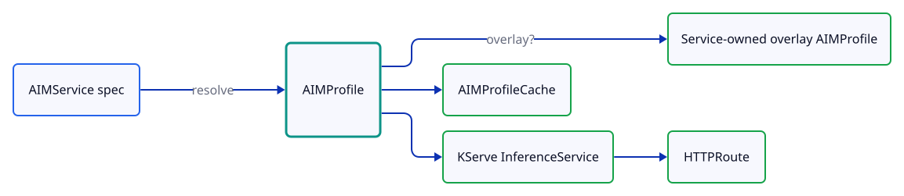

# AIM Services

`AIMService` is the resource you create to deploy an inference endpoint. It binds an `AIMProfile` (the runtime configuration) to optional service-level concerns — caching, routing, autoscaling, resources — and produces a KServe `InferenceService` plus an optional Gateway API `HTTPRoute`.

:::{admonition} v1alpha2
:class: note

This page documents the `aim.eai.amd.com/v1alpha2` API.
:::
## Lifecycle

<picture>
  <source media="(prefers-color-scheme: dark)" srcset="../assets/diagrams/service-lifecycle-dark.svg">
  
</picture>

On every reconcile the controller:

1. **Resolves a profile** — by name, by selector, or by treating `spec.model.name` as a shortcut for "every deployable profile produced by that model".
2. **Materialises an overlay AIMProfile** if `spec.profileOverrides` is set.
3. **Pre-warms the cache** by creating an `AIMProfileCache` for the resolved profile (when caching is enabled).
4. **Builds an InferenceService** mounting the cache PVC, the profile's container image, env, and resource requirements.
5. **Creates an HTTPRoute** if routing is enabled and a `gatewayRef` is configured.
6. **Reports component health** in `status.conditions` and the high-level `status.status` rollup.

## Resolution shapes

A v1alpha2 `AIMService` reaches a deployable `AIMProfile` through one of five shapes. They share the same `spec.model` / `spec.profile` fields but combine them differently.

| Shape | Spec | Use case |
|---|---|---|
| [**By name**](#by-name) | `spec.profile.name` | You know exactly which profile to deploy |
| [**By model**](#by-model) | `spec.model.name` | You know the model; let the controller pick the best deployable profile |
| [**Model + selector**](#model--selector) | `spec.model.name` + `spec.profile.selector` | Narrow a model's profile pool by precision / accelerator / engine |
| [**Global selector**](#global-selector) | `spec.profile.selector` (no `spec.model`) | Reach profiles via labels — `aimId` or `modelRef` required |
| [**By image**](#by-image) | `spec.model.image` | One-shot deploy straight from a container image; the controller looks up or auto-creates an `AIMModel` for that image |

In all shapes except explicit profile name, the controller applies the shared deterministic [profile ranking](../guides/deploying-services.md#ranking) and resolves to a single profile. The resolved profile is recorded in `status.resolvedProfile` (name, scope, kind, uid).

### By name

The lowest-friction shape — references a specific `AIMProfile` or `AIMClusterProfile`.

```yaml
apiVersion: aim.eai.amd.com/v1alpha2
kind: AIMService
metadata:
  name: qwen-chat
  namespace: ml-team
spec:
  profile:
    name: qwen-qwen3-32b-mi300x-fp8-latency
```

Resolution order is namespace first (`AIMProfile`), then cluster (`AIMClusterProfile`). Namespace wins.

### By model

You name the model, the controller picks the profile. This is the recommended default.

```yaml
spec:
  model:
    name: qwen-qwen3-32b
```

`spec.model.name` is shorthand for `spec.profile.selector.modelRef.name` plus the implicit `role=Deployable` filter. The candidate pool is every deployable profile owned by that AIMModel (or AIMClusterModel of the same name). Ranking selects the best.

### Model + selector

Narrow a model's profile pool by hardware or engine criteria.

```yaml
spec:
  model:
    name: qwen-qwen3-32b
  profile:
    selector:
      precision: fp8
      acceleratorModel: MI300X
      metric: latency
```

The selector adds AND filters on top of the model-derived `modelRef.name`. Any selector field documented under [Profile Selectors](profilesets.md#selector) is supported except `role` (see below).

### Global selector

Reach profiles via labels alone, without anchoring to a model.

```yaml
spec:
  profile:
    selector:
      aimId: qwen/qwen3-32b
      precision: fp8
      acceleratorModel: MI300X
```

The CRD requires at least one of `selector.aimId` or `selector.modelRef.name` so the controller's watch fan-out can find this service via O(1) label indexes.

### By image

For one-shot deploys when you only have an AIM container image.

```yaml
apiVersion: aim.eai.amd.com/v1alpha2
kind: AIMService
metadata:
  name: qwen-chat
  namespace: ml-team
spec:
  model:
    image: amdenterpriseai/aim-qwen-qwen3-32b:0.8.5
```

The resolver looks up an existing `AIMModel`/`AIMClusterModel` whose `spec.image` matches. If exactly one matches, the resolver treats it as if you had written `spec.model.name: <that model>` and ranks as usual. If none matches, the plan step **creates a dedicated, service-owned `AIMModel`** in the service's namespace with:

- `metadata.ownerReferences` pointing at the service (garbage collected with the service).
- Label `aim.eai.amd.com/origin=auto-generated`.
- Annotation `aim.eai.amd.com/auto-source=spec.model.image`.

If multiple existing models match the same image (rare; not recommended), the resolver reports `ProfileNotFound` and asks you to disambiguate via `spec.model.name`.

Image-shape services pair best with `caching.mode: Shared` only when you intentionally apply a long-lived `AIMModel` for the image and reference it via `spec.model.name` instead — auto-created models are per-service.

### Reserved selector fields

`spec.profile.selector.role` is **reserved** on `AIMService`. The controller forces `role: deployable` at evaluation time. Omitting the field is fine; explicitly setting `role: deployable` is fine; setting `role: base` (or any other value) is rejected at admission.

This guarantees a service never resolves to a base profile.

## Profile binding stability

The resolver is **sticky-once-bound**: once `status.resolvedProfile` is set, the controller keeps using that profile on every subsequent reconcile, provided the profile still exists and still satisfies the current selector.

This protects running services from silently switching profiles when the candidate pool changes for reasons unrelated to the service spec. The classic trigger is adding a second `AIMModel` in the same namespace with overlapping `aimId` — without stickiness, the ranker might pick a different-precision profile from the newer model and rebind the running service to fp8 weights when it was happily serving fp16, complete with a fresh cache download and a predictor pod roll.

### When the binding is re-evaluated automatically

A natural rebind happens when the existing binding is no longer usable:

| Trigger | Mechanism |
|---|---|
| Bound profile deleted | The `Get` for `status.resolvedProfile` returns NotFound → re-rank against remaining candidates. |
| Bound profile no longer matches the current selector | The user narrowed `spec.profile.selector` (or [changed the model](#change-a-services-model)) and the bound profile no longer passes the filter → re-rank with the new intent. |
| Bound profile drops below the `minimumType` floor | The bound profile's `type` is now below the selector's `minimumType` (e.g. retyped to `unoptimized` while the floor is `optimized`) → re-rank. |
| Transient infrastructure error fetching the bound profile | Re-rank rather than risk serving a stale binding through an outage. |

Each natural rebind emits a `Normal` event with reason `ProfileRebound` naming the previous profile, the new profile, and the trigger reason — so `kubectl describe aimservice` always tells you why a binding changed.

### Forcing a rebind explicitly

When you intentionally want the resolver to pick again (e.g. an image upgrade landed a new published profile and you want the service to adopt it), set the `aim.eai.amd.com/force-rebind` annotation to any non-empty value:

```bash
kubectl annotate aimservice my-svc \
  aim.eai.amd.com/force-rebind=now --overwrite
```

On the next reconcile the resolver ignores the sticky binding, re-ranks from scratch, and (if the winner differs) emits the same `ProfileRebound` event with `force-rebind` as the reason.

The operator does NOT clear the annotation. Remove it once the desired rebind has happened to return to sticky behavior:

```bash
kubectl annotate aimservice my-svc aim.eai.amd.com/force-rebind-
```

Leaving the annotation in place is safe — the ranker is deterministic and `ProfileRebound` only fires when the winner actually changes — but it forgoes the stability guarantee of the sticky default, so the next time a higher-ranked candidate appears the service will silently adopt it.

### Pinning to a specific profile

Stickiness is a default-on protection, not a guarantee. The strongest guarantee is `spec.profile.name`: by name there's no ranking at all, so the binding is fixed for the lifetime of the spec.

### Change a service's model

`spec.model` can't be edited in place. To move a service to another AIMModel, remove `spec.model` and set `spec.profile.name` to one of the new AIMModel's AIMProfiles in one update. To select by model again, add `spec.model.name` back and remove `spec.profile` in a second update:

```bash
kubectl get aimprofile -n <namespace> -l aim.eai.amd.com/source-model=<new-model>
kubectl patch aimservice <service> -n <namespace> --type merge \
  -p '{"spec":{"model":null,"profile":{"name":"<AIMProfile of the new model>"}}}'
kubectl patch aimservice <service> -n <namespace> --type merge \
  -p '{"spec":{"model":{"name":"<new-model>"},"profile":null}}'
```

The first update rolls the service's InferenceService onto the new AIMProfile in place. The second keeps that binding, because the AIMProfile belongs to the new model. A service that already uses `spec.profile.name` changes model by pointing it at another AIMProfile. When both `spec.profile.name` and `spec.model` are set, `spec.profile.name` wins and `spec.model` is ignored.

Once the predictor rollout finishes, the controller deletes the Dedicated AIMProfileCache and the overlay AIMProfile the service used for the old AIMProfile. Shared AIMProfileCaches stay; they belong to their AIMProfile.

## Profile overlays

Sometimes you want to tweak a published profile for one service without forking it. `spec.profileOverrides` creates a service-owned **overlay AIMProfile** derived from the profile that `spec.profile` resolves:

```yaml
spec:
  profile:
    name: qwen-qwen3-32b-fp8-mi300x
  profileOverrides:
    modelSources:
      - modelId: my-org/qwen3-32b-finetune
        sourceUri: hf://my-org/qwen3-32b-finetune
    containerEnv:
      - name: AIM_OVERRIDE_NOTE
        value: "service overlay rebases the seed profile onto custom weights"
```

What happens:

1. The controller materialises an `AIMProfile` named `<seed>-<service>-overlay-<hash>` in the service's namespace.
2. The overlay carries `profile-role: deployable`, `profile-origin: derived`, and an annotation pointing back at the service.
3. Downstream (cache, ConfigMap, KServe wiring) keys off the overlay — so the override participates in cache-key computation, not just runtime env wiring.
4. The overlay is owner-referenced by the service and garbage-collected on service deletion, or once the service has rolled out on another AIMProfile.

The override field set mirrors [`ProfileOverrides`](profilesets.md#overrides)
used by AIMProfileSet derivation — the same internal primitive applies both.
Feature overrides are additive and can explicitly assert capabilities such as
`adapters` when a legacy or custom profile omits the corresponding metadata.

When `profileOverrides.modelSources` replaces the seed's weights, the seed must
identify its clean AIM runtime. Discovered profiles receive this from
`AIM_BASE_IMAGE_REF`; hand-authored deployable profiles set
`spec.baseImageRef`, which supplies the aim-base name and tag; the registry and
org come from the selected RuntimeConfig's `baseImageRegistry`, or from the
seed's `spec.image`. If it is absent, the service reports
`BaseImageUnresolved`, retains any existing inference resources, and does not
guess from the seed image's registry or tag. Configuration-only overlays do
not require the field.

`spec.profileOverrides` requires `spec.profile` (`name` or `selector`). The API server refuses it on a service without `spec.profile`, for example the by-model and by-image shapes.

## Caching

When the resolved profile has `spec.caching.enabled: true` (namespace-scoped profiles only) or the service has its own `spec.caching` block, the controller creates an `AIMProfileCache` that pre-downloads the profile's `modelSources` onto a PVC before the InferenceService starts.

| Mode | Behavior |
|---|---|
| `Shared` (default) | The cache PVC is shared across services using the same profile. Reused indefinitely; outlives any single service. |
| `Dedicated` | Each service gets its own cache PVC, deleted with the service or once the service has rolled out on another AIMProfile. |

```yaml
spec:
  caching:
    mode: Dedicated
```

See [Model Caching](caching.md) for the full hierarchy (AIMProfileCache → AIMArtifact → PVC + Download Job).

## Resources and replicas

| Field | Description |
|---|---|
| `replicas` | Fixed replica count. Default `1`. |
| `minReplicas` / `maxReplicas` | Enables KEDA-driven autoscaling between the bounds. |
| `autoScaling` | Custom metric configuration (typically vLLM OTEL metrics). See [Scaling and Autoscaling](../guides/scaling-and-autoscaling.md). |
| `resources` | Optional per-key override for container resources. Fully merged on top of the resolved profile's `status.resources`; the merged footprint is used for node matching and can make a service deployable even when the profile's larger defaults are unavailable. |
| `imagePullSecrets` | Service-level secrets, merged with the profile's. |
| `serviceAccountName` | Pod service account for the inference workload. |
| `priorityClassName` | Pod priority class. |
| `tolerations` | Pod tolerations for the inference workload and its adapter staging Jobs. Replaces the runtime config's list as a whole; `[]` removes it. See [Tolerations](runtime-config.md#tolerations). |
| `podSecurityContext` / `securityContext` | Pod security context and inference container security context. Each one replaces the runtime config's value as a whole, also when it is `{}`. See [Security contexts](runtime-config.md#security-contexts). |

For example, a one-GPU service can override CPU and memory while inheriting the
profile's accelerator request and limit:

```yaml
spec:
  resources:
    requests:
      cpu: "8"
      memory: 64Gi
    limits:
      cpu: "16"
      memory: 128Gi
```

## Serving API

`spec.servingAPI` selects the KServe API that serves the service:

| Value | Served by |
|---|---|
| `Auto` (default) | AIM Engine's choice. Currently `InferenceService`. |
| `InferenceService` | A KServe `InferenceService` that references the profile's projected `ServingRuntime`. |
| `LLMInferenceService` | A KServe `LLMInferenceService` that references the profile's projected `LLMInferenceServiceConfig` through `spec.baseRefs`. |

The field is immutable. The resolved API is recorded in `status.servingAPI` the first time the service reconciles and is kept for its lifetime, so a later change to what `Auto` selects never moves an existing service to a different API.

```yaml
apiVersion: aim.eai.amd.com/v1alpha2
kind: AIMService
metadata:
  name: qwen-chat
spec:
  profile:
    name: qwen3-32b-mi300x
  servingAPI: LLMInferenceService
```

`LLMInferenceService` requires:

- `spec.profile`, because only the profile pipeline serves it;
- the KServe LLMInferenceService controller and its CRDs, installed before AIM Engine starts (see [KServe Configuration](../admin/kserve-configuration.md#llminferenceservice-support));
- a profile whose first model source has a URI scheme (for example `hf://`).

Caching, replicas, autoscaling (including scale-to-zero), resource overrides, routing, LoRA adapters (`spec.adapters`, `adapterMode: dynamic`), pull secrets, the service account, priority class, and additional CA bundles behave as they do for an `InferenceService`. Adapters are staged onto the adapter disk and mounted into the `main` container exactly as for an `InferenceService`; KServe's own `spec.model.lora` download path is not used.

AIM Engine keeps owning the `HTTPRoute` and the KEDA `ScaledObject`. It does not use the `LLMInferenceService` `spec.router` field (KServe-managed Gateway, `HTTPRoute`, scheduler and `InferencePool`) or the `spec.scaling` field (Workload Variant Autoscaler). See [KServe Configuration](../admin/kserve-configuration.md#llminferenceservice-support) for how the two models differ.

### Additional LLMInferenceServiceConfigs

`spec.llmInferenceService.baseRefs` merges additional `LLMInferenceServiceConfig`s into the workload, for example shared vLLM arguments, tracing sidecars, or scheduling constraints maintained by a platform team:

```yaml
spec:
  profile:
    name: qwen3-32b-mi300x
  servingAPI: LLMInferenceService
  llmInferenceService:
    baseRefs:
      - name: team-vllm-args
      - name: team-tracing
```

KServe merges, in order: its built-in templates, the profile's projected config, the listed configs in list order, and finally the fields AIM Engine sets on the `LLMInferenceService` (model, replicas, cache and adapter mounts, and resources when `spec.resources` is set). Later entries win, and maps such as resource lists merge per key while lists such as node selector terms are replaced. Each name resolves in the service's namespace first, then in KServe's system namespace, matching KServe's own lookup. Editing a referenced config rolls the workload.

Referenced configs must not set fields AIM Engine owns: `spec.router`, `spec.replicas`, `spec.scaling`, `spec.prefill`, `spec.worker`, or `spec.model.lora`. A missing or conflicting config sets `LLMInferenceServiceBaseRefsReady=False` and `ConfigValid=False`, and AIM Engine does not create or update the `LLMInferenceService` until it is fixed. The list holds at most 16 unique names and the `aim-` prefix is reserved for configs AIM Engine projects.

Any other field may override the profile, and the outcome is the config author's responsibility. AIM Engine reports overrides of the profile's contract on the informational `ProfileContractIntact` condition, which never affects `Ready`:

| Override | Why it is reported |
|---|---|
| `spec.parallelism`, `spec.kvCacheOffloading` | KServe applies these through its own vLLM launch script, which the profile's launch replaces, so they have no effect |
| `main` container `image`, `command`, `args` | Replaces the profile's engine and launch, so the profile's settings may no longer apply |
| `main` container `amd.com/gpu` / `nvidia.com/gpu` requests or limits that differ from the profile | The profile's engine settings (for example tensor parallelism) assume its accelerator count. Not reported when `spec.resources` is set, because the service's resources then win |
| `spec.template.affinity.nodeAffinity` that differs from the profile | Replaces the profile's node selector terms, which pin the accelerator model |

`ProfileContractIntact=False` (reason `ProfileContractOverridden`) lists each config and the fields it overrides, and emits a Warning event when it changes. `True` (reason `NoProfileOverrides`) confirms that the configs leave the contract alone.

## Routing

Optionally expose the service through Gateway API:

```yaml
spec:
  routing:
    enabled: true
    gatewayRef:
      name: inference-gateway
      namespace: gateways
    pathTemplate: "/team/{.metadata.labels['team']}/chat"
```

The controller creates an `HTTPRoute` that attaches to the referenced Gateway. The `pathTemplate` supports JSONPath expressions referencing service metadata. See [Routing and Ingress](../guides/routing-and-ingress.md).

## Status

### High-level status

| Status | Meaning |
|---|---|
| `Pending` | Resolving the profile or waiting on upstream dependencies |
| `Starting` | Profile resolved; creating cache and InferenceService |
| `Running` | InferenceService is ready and serving traffic |
| `Degraded` | Partially functional — typically routing or cache issues with a healthy inference path |
| `Failed` | Terminal error preventing deployment |

### Status fields

| Field | Description |
|---|---|
| `resolvedProfile` | The profile that was resolved (`name`, `scope`, `kind`, `uid`). The single source of truth for which profile is backing this service. |
| `servingAPI` | The KServe API serving the service (`InferenceService` or `LLMInferenceService`), recorded once and kept |
| `resolvedRuntimeConfig` | The runtime config (if any) that contributed defaults |
| `cache` | Cache state — `profileCacheRef`, `retryAttempts` |
| `runtime` | Replica counts when autoscaling is active (`currentReplicas`, `desiredReplicas`, `minReplicas`, `maxReplicas`) |
| `routing` | Observed routing including the rendered HTTP path |
| `conditions` | Per-component conditions — see below |

### Conditions

The v1alpha2 service reports these component conditions:

| Condition | What it tracks |
|---|---|
| `ProfileReady` | Profile resolution (`ProfileResolved`, `ProfileNotFound`, `BaseProfile`) |
| `ProfileCacheReady` | `AIMProfileCache` artifact downloads |
| `InferenceServiceReady` | KServe `InferenceService` readiness |
| `LLMInferenceServiceReady` | KServe `LLMInferenceService` readiness (replaces `InferenceServiceReady` when `servingAPI` is `LLMInferenceService`) |
| `LLMInferenceServiceBaseRefsReady` | Resolution of `spec.llmInferenceService.baseRefs` (`LLMInferenceServiceConfigsResolved`, `LLMInferenceServiceConfigNotFound`, `LLMInferenceServiceConfigConflict`); only when the field is set |
| `ServingAPIReady` | Reported `False` (`ServingAPIUnsupported`, together with `ConfigValid=False`) when the requested serving API cannot be served, for example without the LLMInferenceService CRDs |
| `LLMInferenceServiceAutoscalingReady` | Reported `False` (`OpenTelemetryCollectorUnavailable`, together with `ConfigValid=False`) when an autoscaled LLMInferenceService-served service runs on a cluster without the OpenTelemetryCollector CRD |
| `HTTPRouteReady` | Gateway API route acceptance (only when routing is enabled) |
| `HPAReady` | KEDA-managed autoscaler health (only when autoscaling is enabled) |
| `Ready` | Aggregate of all above |

Two informational conditions are not part of `Ready`: `ActivationMetricAvailable` (scale-from-zero activation signal) and `ProfileContractIntact` (see [Additional LLMInferenceServiceConfigs](#additional-llminferenceserviceconfigs)).

When `ProfileReady=False` (profile not found, or resolved to a base profile), the controller **suppresses** the downstream `InferenceServiceReady` / `HTTPRouteReady` entries — those resources aren't being created until the profile resolves, so reporting them as "Creating" would be misleading.

See [Conditions Reference](../reference/conditions.md) for the full reason catalogue.

## Validation

CEL admission rules reject these spec shapes:

| Rejected on v1alpha2 | Use instead |
|---|---|
| `spec.template` (any value) | `spec.profile` (or `spec.model`) |
| `spec.overrides` | `spec.profileOverrides` |
| `spec.model.custom` | An `AIMModel` referenced with `spec.model.name` |
| Neither `spec.model` nor `spec.profile` | Set at least one |
| `spec.profileOverrides` without `spec.profile` | Set `spec.profile` (`name` or `selector`) |
| `spec.profile.selector.role: base` | Omit `role` or set `deployable` |
| `spec.profile.selector` without `aimId`, `modelRef`, or paired `spec.model` | Add one of those anchor fields |
| Changing `spec.servingAPI` after creation | Create a new service |
| `spec.servingAPI: LLMInferenceService` without `spec.profile` | Set `spec.profile` |
| `spec.llmInferenceService` without `spec.servingAPI: LLMInferenceService` | Set `spec.servingAPI: LLMInferenceService` or drop the field |
| `spec.llmInferenceService.baseRefs` with duplicate names, empty names, or the `aim-` prefix | Use unique, non-reserved names |

The `spec.template`, `spec.overrides` and `spec.model.custom` rules reject the field on create and on updates that add it. An existing service that already has the field stays updatable and reports it in a [`TemplateFieldsIgnored`](../reference/conditions.md#templatefieldsignored) warning.

See [Resource lifecycle → validation](resource-lifecycle.md#validation) for the canonical list of validation rules across all v1alpha2 CRDs.

## Examples

### Minimal deploy by name

```yaml
apiVersion: aim.eai.amd.com/v1alpha2
kind: AIMService
metadata:
  name: qwen-chat
  namespace: ml-team
spec:
  profile:
    name: qwen-qwen3-32b-mi300x-fp8-latency
```

### Auto-select for a model, with autoscaling

```yaml
apiVersion: aim.eai.amd.com/v1alpha2
kind: AIMService
metadata:
  name: qwen-chat
  namespace: ml-team
spec:
  model:
    name: qwen-qwen3-32b
  minReplicas: 1
  maxReplicas: 5
  autoScaling:
    metrics:
      - type: PodMetric
        podmetric:
          metric:
            backend: opentelemetry
            metricNames:
              - vllm:num_requests_running
            query: "vllm:num_requests_running"
            operationOverTime: avg
          target:
            type: Value
            value: "1"
```

Autoscaling between `minReplicas` and `maxReplicas` requires at least one metric (or `minReplicas: 0` for scale-from-zero); otherwise the spec is rejected with `ConfigValid=False` (reason `AutoscalingRequiresMetrics`).

### Custom weights via overlay

```yaml
apiVersion: aim.eai.amd.com/v1alpha2
kind: AIMService
metadata:
  name: qwen-finetune
  namespace: ml-team
spec:
  profile:
    name: qwen-qwen3-32b-mi300x-fp8-latency
  profileOverrides:
    modelSources:
      - modelId: acme/qwen3-32b-finetune
        sourceUri: hf://acme/qwen3-32b-finetune
```

### Selector with HTTP routing

```yaml
apiVersion: aim.eai.amd.com/v1alpha2
kind: AIMService
metadata:
  name: qwen-chat
  namespace: ml-team
spec:
  profile:
    selector:
      aimId: qwen/qwen3-32b
      precision: fp8
      acceleratorModel: MI300X
      metric: latency
  routing:
    enabled: true
    gatewayRef:
      name: inference-gateway
      namespace: gateways
```

## Troubleshooting

### Service stuck in `Pending` with `ProfileNotFound`

The resolver found no candidates. Check:

```bash
kubectl get aimservice <name> -o jsonpath='{.status.conditions[?(@.type=="ProfileReady")].message}'
```

Common causes:

- `spec.profile.name` typo or wrong scope (namespace vs cluster).
- `spec.model.name` doesn't match any AIMModel/AIMClusterModel that has produced deployable profiles. Check `kubectl get aimmodel <name> -o jsonpath='{.status.managedProfiles}'`.
- Selector is too restrictive — relax `precision`, `acceleratorModel`, or `acceleratorCount`.

### Service `ProfileReady=False / BaseProfile`

`spec.profile.name` points at a base profile (status.deployable=false). Base profiles can't back services directly — either reference a deployable profile, or derive a deployable one through a custom-model AIMModel ([Custom Models](../guides/custom-models.md)) and reference that.

### Service is `Running` but throughput is unexpected

The resolved profile may not be the one you expected. Check `status.resolvedProfile`:

```bash
kubectl get aimservice <name> -o jsonpath='{.status.resolvedProfile}'
```

If the wrong profile was selected, narrow `spec.profile.selector` (or switch to `spec.profile.name`) to pin the choice.

## Related documentation

- [Deploying Services](../guides/deploying-services.md) — Task-oriented walkthroughs
- [Profiles](profiles.md) — What `AIMProfile` carries; provenance and status fields
- [AIM Models](models.md) — Four model flows that produce profiles for services to resolve
- [Model Caching](caching.md) — Cache modes and storage configuration
- [Scaling and Autoscaling](../guides/scaling-and-autoscaling.md) — KEDA integration and metric backends
- [Routing and Ingress](../guides/routing-and-ingress.md) — Gateway API patterns
- [Conditions Reference](../reference/conditions.md) — Full condition catalogue
- [CRD API Reference (v1alpha2)](../reference/api/v1alpha2.md) — Full schema
