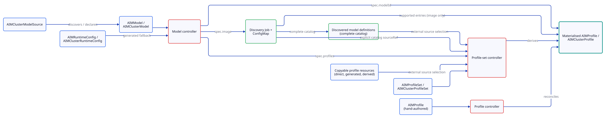
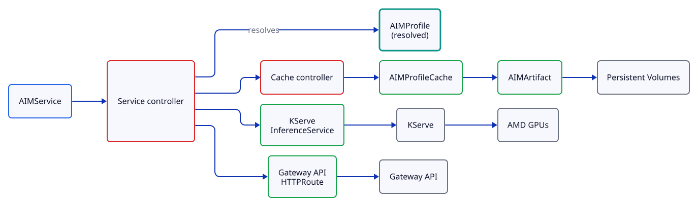
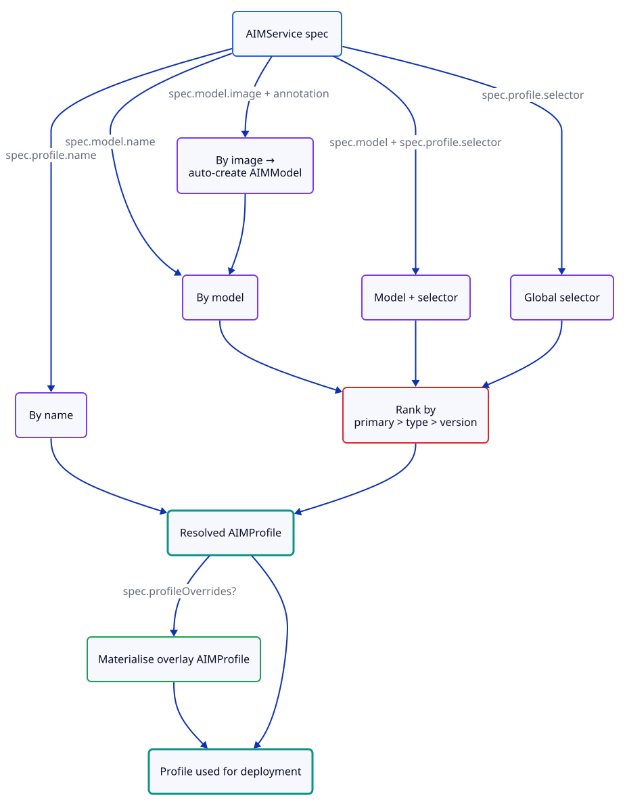

# Architecture

AIM Engine is a Kubernetes operator that orchestrates the full lifecycle of AI inference workloads on supported AMD and NVIDIA GPUs. It bridges the gap between model artifacts and production-ready inference endpoints by coordinating several Kubernetes-native components.

## High-level architecture

AIM Engine has two cooperating flows that meet at the `AIMProfile`: **onboarding** turns models into deployable profiles, and **serving** turns a profile into a running endpoint. Throughout these diagrams, colour denotes the kind of resource — blue for user-applied, red for operator controllers, green for operator-managed, grey for infrastructure.

### Onboarding: from models to profiles

Official models (via image discovery), generated models (via RuntimeConfig fallbacks), profile sets (via derivation), and hand-authored profiles all converge on a deployable `AIMProfile`.

<picture>
  <source media="(prefers-color-scheme: dark)" srcset="../assets/diagrams/model-onboarding-dark.svg">
  
</picture>

### Serving: from profile to endpoint

An `AIMService` resolves one of those profiles, and the Service controller creates the cache, InferenceService, and route that back a running endpoint.

<picture>
  <source media="(prefers-color-scheme: dark)" srcset="../assets/diagrams/service-deployment-dark.svg">
  
</picture>

## CRDs and their roles

v1alpha2 is the current API. v1alpha1 resources remain supported during the deprecation window — see [Legacy v1alpha1](../legacy/index.md).

| CRD | Scope | Role |
|---|---|---|
| `AIMService` | Namespace | Deploys an inference endpoint by resolving a profile and creating a KServe InferenceService. |
| `AIMModel` / `AIMClusterModel` | Namespace / Cluster | Onboards a model — four flows (official, generated, fine-tuned, custom). Produces profiles. |
| `AIMProfile` / `AIMClusterProfile` | Namespace / Cluster | Self-contained runtime configuration (image, accelerator, engine args, model sources). The unit a service resolves to. |
| `AIMProfileSet` / `AIMClusterProfileSet` | Namespace / Cluster | Selects across model definitions and copyable profile resources, applies overrides, and materialises derived profiles. Also synthesised by `AIMModel.spec.profiles`. |
| `AIMProfileCache` | Namespace | Pre-warms a profile's `modelSources` to a PVC for fast service start. |
| `AIMArtifact` | Namespace | Manages a single model artifact download to a PVC. |
| `AIMClusterModelSource` | Cluster | Auto-discovers AIM images from a registry (`spec.filters`/`spec.images`) or materializes declared model IDs (`spec.models`). Declared models are created as v1alpha2 `AIMClusterModel`, since `spec.modelId` is a v1alpha2-only field; discovered images are created as v1alpha1. Both are the same stored object — v1alpha2 is the storage version. |
| `AIMRuntimeConfig` / `AIMClusterRuntimeConfig` | Namespace / Cluster | Storage defaults, routing defaults, environment defaults. |

## Four model flows

Every `AIMModel` resolves to one of four flows, selected by which spec field is set. The full mechanics live in [AIM Models](../concepts/models.md):

| Flow | Spec | Source of profiles |
|---|---|---|
| **Image-backed** | `spec.image` | Image discovery and hardware-supported profile materialisation |
| **Generated** | `spec.modelId` | Hardware-matched RuntimeConfig fallbacks |
| **Fine-tuned** | `spec.profiles.derivedFrom` (selecting deployable profiles) | A previously-applied official AIMModel |
| **Custom** | `spec.profiles.derivedFrom` (selecting base-image base profiles) | A previously-applied base-image AIMModel |

An image-backed model accepts `profiles.overrides` on its own or with `profiles.derivedFrom.selector` to narrow the image's definitions. Without `image`, `profiles` requires `derivedFrom` and selects external sources. `modelId` is exclusive with `image` and `profiles`.

Image discovery retains all profile definitions for derivation. Ordinary image onboarding materialises hardware-supported entries. Separate profile sets and derived models select across published definitions and existing copyable profiles with the same filters, including when the source hardware is absent. Services resolve actual profile resources.

## Service resolution

When you apply an `AIMService`, the controller reaches a single `AIMProfile` through one of five resolution shapes:

<picture>
  <source media="(prefers-color-scheme: dark)" srcset="../assets/diagrams/service-resolution-dark.svg">
  
</picture>

The image shape requires the `aim.eai.amd.com/reconciler-pipeline: profile` annotation during the migration window — see [Migration window](../admin/upgrading.md#migration-window). See [Services](../concepts/services.md#resolution-shapes) for the canonical resolution table and mechanics.

## Cluster vs namespace scope

Several CRDs have both a namespace-scoped and a cluster-scoped variant.

| Namespace | Cluster | Purpose |
|---|---|---|
| `AIMModel` | `AIMClusterModel` | Model definitions |
| `AIMProfile` | `AIMClusterProfile` | Runtime configurations |
| `AIMProfileSet` | `AIMClusterProfileSet` | Profile derivation |
| `AIMRuntimeConfig` | `AIMClusterRuntimeConfig` | Storage, routing, environment defaults |

**Cluster-scoped** resources are shared across all namespaces. Platform admins create them to provide a model catalog and validated runtime profiles.

**Namespace-scoped** resources are visible only within their namespace. Teams create them for custom models or per-project overrides.

### Resolution order

When an AIMService needs a model or profile, AIM Engine resolves it in this order:

1. **Namespace** — look for the resource in the service's namespace.
2. **Cluster** — fall back to the cluster-scoped variant.

Namespace wins. The resolved scope is recorded in `status.resolvedModel.scope` and `status.resolvedProfile.scope`.

**RuntimeConfig** is special: if both namespace and cluster configs exist, they're **merged** rather than one replacing the other. Namespace values override cluster values for any fields set in both.

## Reconciliation pipeline

Every AIM controller follows the same pipeline:

<picture>
  <source media="(prefers-color-scheme: dark)" srcset="../assets/diagrams/reconcile-pipeline-dark.svg">
  
</picture>

Each step is idempotent: the operator converges toward the desired state on every reconciliation, handling partial failures and eventual consistency gracefully.

## Integration points

| Component | Role |
|---|---|
| **KServe** | Underlying model serving runtime. AIM Engine creates and manages `InferenceService` resources. |
| **Gateway API** | HTTP routing. When routing is enabled, AIM Engine creates `HTTPRoute` resources attached to a configured Gateway. |
| **Persistent Volumes** | Back the caching system. `AIMProfileCache` downloads model artifacts once to shared (or dedicated) PVCs. |
| **AMD/NVIDIA GPUs + NFD** | Detected through model and vendor labels (`feature.node.kubernetes.io/aim-accelerator.*`) written by the AcceleratorDetector DaemonSets. Profile resolution filters candidates by node-label availability and vendor-specific device capacity. |

## Where to read next

- [Quickstart](quickstart.md) — Deploy a service in minutes
- [AIM Models](../concepts/models.md) — Four model flows in detail
- [Services](../concepts/services.md) — Resolution shapes, overlays, caching
- [Profiles](../concepts/profiles.md) — Self-contained runtime configurations
- [AIM Profile Sets](../concepts/profilesets.md) — Derivation engine
